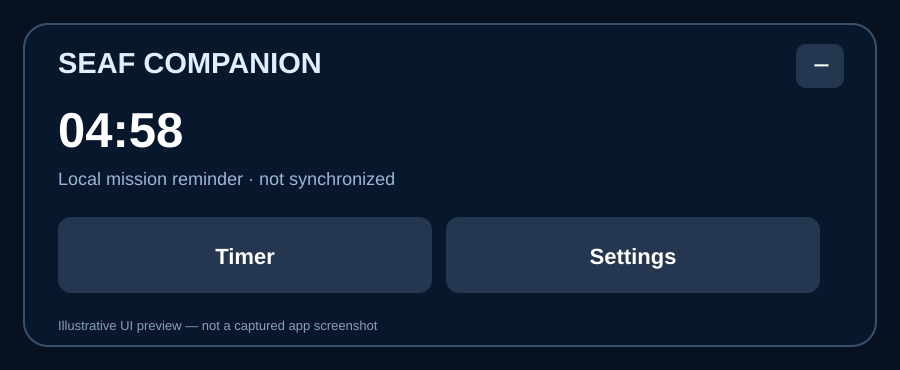

# SEAF Companion

**Unofficial Android companion for [Adopt-a-SEAF](https://seaf.se/)** — a fullscreen-friendly in-app game view with a collapsible companion panel and local mission reminders.

> **Development preview — not a verified official SEAF app or a production release.** SEAF Companion is independently developed and is not affiliated with, endorsed by, or supported by the operators of seaf.se or the owners of any referenced game properties.

## Features
- Original **seaf.se** game displayed within Android WebView; the game continues to handle its own login and state.
- Compact companion panel, responsive to portrait and landscape.
- Manually scheduled mission reminders with Android notifications; countdown, cancel, and reboot restoration.
- Notification tap opens the app; notification sound can be managed through Android's system notification-channel settings.
- Local timer logic does **not** synchronize with SEAF servers; no claim of automatic mission detection.

## Screenshots


*Illustrative interface preview, not an actual app screenshot.* Authentic Play Store screenshots are still pending privacy and intellectual-property review. See [screenshot guidance](docs/SCREENSHOTS.md). Do not publish screenshots that reveal player handles, account information, or notification contents without review.

## Installation (testing only)
1. Open [Actions](../../actions/workflows/android.yml) and select a successful build.
2. Download the `SEAF-Companion-debug-APK` artifact and extract `app-debug.apk`.
3. Install on an Android device that permits sideloading.
4. **Update warning:** Android requires every update to have the same package name, a compatible increasing version code, and the **same signing certificate**. Uninstalling can erase login/session data. Do not uninstall just to fix a failed update.

Debug builds are for development, **not Google Play submission**. Production distribution requires an independently protected release signing key, a release build/AAB, and policy review. See [release guide](docs/RELEASING.md).

## Privacy and security
- The Android app requires internet access to display the third-party website.
- Notification permission is requested on Android 13+ for reminders.
- Reminder deadlines are stored locally in app preferences.
- Game login, cookies, and third-party network traffic are handled by Android WebView and the game website; see [privacy notice](PRIVACY.md).
- No independent telemetry or analytics SDK is present in the current codebase. **This is a code-level observation, not an audit of seaf.se.**
- The source and GitHub Actions build process are publicly reviewable *if the repository is made public*; this alone does not establish trust or prove that binaries are safe.

## Project structure
```
app/src/main/java/com/seaf/companion/  Android UI, WebView, reminders
app/src/main/res/                    Icons and bundled assets
.github/workflows/android.yml         CI debug APK build
docs/                                 Publication, security and test guidance
```

## Documentation
- [Getting started and development](docs/DEVELOPMENT.md)
- [Release preparation and Play Store checklist](docs/RELEASING.md)
- [Privacy notice (draft)](PRIVACY.md)
- [Security policy](SECURITY.md)
- [Screenshots and listing assets](docs/SCREENSHOTS.md)
- [Third-party attribution and rights](THIRD_PARTY_NOTICES.md)
- [Changelog](CHANGELOG.md)

## Support
Use [GitHub Issues](../../issues) for bug reports, avoiding credentials, account identifiers, tokens, or private screenshots.

## License
**No license has been granted for this repository's code or bundled third-party assets.** Rights and a distributable source license must be confirmed before open-source publication. See [third-party notices](THIRD_PARTY_NOTICES.md).
